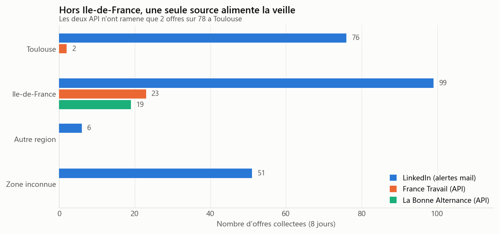
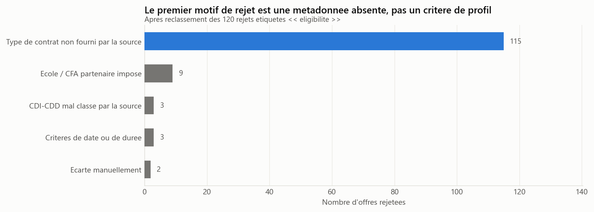
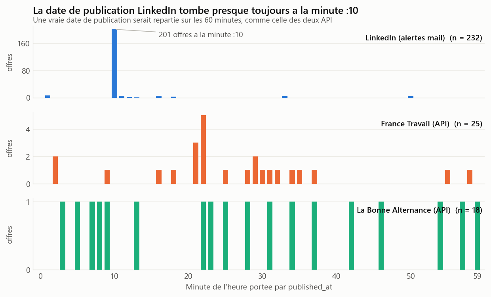

# Couverture et qualité des sources d'offres d'alternance IT

**Toulouse vs Île-de-France — snapshot du 3 octobre 2026**

Analyse exploratoire de **276 offres réellement collectées** par un pipeline de
veille que j'exploite sur un serveur, alimenté par trois sources : les alertes
mail LinkedIn, l'API France Travail et l'API La Bonne Alternance.

L'objet étudié n'est pas le marché de l'emploi, c'est **le pipeline lui-même** :
ce que chaque source apporte, ce qu'elle perd, et ce qu'on peut honnêtement en
conclure.

> ### ⚠️ Échantillon de ma recherche, pas du marché
>
> Les 276 offres sont celles que *mes* requêtes et *mes* alertes ont ramenées,
> sur *mes* deux zones, pendant *huit jours*. Aucun chiffre de ce dépôt ne décrit
> le marché français de l'alternance IT, et aucun n'est présenté comme tel.

---

## Les trois résultats

### 1. Deux contrôles de cohérence sur cinq échouent — et changent tout le reste

Le notebook commence par vérifier les données avant de les analyser. Deux
contrôles tombent :

| Contrôle | Verdict | Conséquence |
|---|---|---|
| Identité de l'entonnoir sur 554 runs | ✅ exact | Les compteurs de collecte sont exploitables |
| Réconciliation `runs` ↔ table d'offres | ❌ **écart de 46** | La table a été réinitialisée : la fenêtre réelle est de **8 jours, pas 11** |
| Unicité des identifiants | ✅ | — |
| Couverture temporelle des runs | ✅ | — |
| Absence d'import en masse | ❌ **133 offres** | Pour ces lignes, `first_seen_at` est une heure de chargement, pas de détection |

Aucun des deux défauts n'était visible dans une table prise isolément : il a fallu
confronter le journal de collecte à la table d'offres.

### 2. Toulouse ne tient qu'à un fil



**97 % des offres toulousaines viennent d'une source unique** — le dépouillement
des alertes mail. Les deux API, interrogées avec les mêmes requêtes sur les deux
villes, n'en ont ramené que 2 sur 78. En Île-de-France, trois sources se
recoupent. Une panne du dépouillement de mails ferait disparaître la quasi-totalité
de la visibilité sur Toulouse.

Et c'est la même source qui perd la localisation : **les 51 offres en zone
inconnue viennent toutes de là** — 41 parce que le mail ne porte pas de lieu
exploitable, 10 à cause d'un bug de parsing qui range le nom de l'entreprise dans
le champ « lieu » quand il contient le mot « France ».

### 3. Le premier motif de rejet n'est pas un critère de profil



Telle quelle, la base affirme que **120 des 132 offres rejetées** l'ont été pour
« éligibilité ». Reprise sans vérification, cette étiquette donne : *« 91 % des
offres rejetées ne correspondent pas à mon profil »*.

C'est faux. Le journal de décision montre que **115 de ces 120 rejets** portent la
mention `type de contrat incompatible : None` — la source n'a fourni **aucun**
type de contrat, et le moteur a traité l'absence d'information comme une
incompatibilité. Le reclassement est fait dans le notebook à partir du journal ;
la colonne d'origine est conservée et affichée à côté.

Véritables rejets sur critère de profil : **3 offres sur 276**.

### Bonus — un résultat négatif, et pourquoi il compte



La table semblait fournir 275 délais de détection. Trois vérifications plus tard,
il en reste **3**, et la réactivité de la veille n'est **pas mesurable** sur ce
snapshot.

En cause : `published_at` de LinkedIn n'est pas une date de publication, c'est
l'heure d'arrivée du mail d'alerte. Trois indices le prouvent — l'horodatage ne
prend que 9 valeurs de minute sur 60 (87 % à `:10`), 101 offres présentent
exactement 51 minutes d'écart avec leur détection, et l'historique s'arrête net au
démarrage de la boîte mail.

Sans ce diagnostic, la lecture naïve aurait donné *« LinkedIn est 537 fois plus
réactif que France Travail »*. C'est un artefact : on comparait la latence d'une
tâche planifiée à l'âge réel d'une annonce.

---

## Méthode

- **Confidentialité par construction.** Les colonnes nominatives
  (`title`, `company`, `canonical_url`, `notes`, `location`) sont supprimées au
  chargement, après en avoir dérivé des indicateurs booléens. Une assertion le
  vérifie. Aucun `head()` ne peut les trahir, y compris dans une cellule ajoutée
  plus tard.
- **Exports verrouillés.** La fonction d'export refuse tout tableau de plus de
  40 lignes ou contenant une colonne nominative. `data/public/` ne contient que
  des agrégats.
- **Sorties vidées avant commit** via `nbstripout` : aucun extrait d'offre ne
  transite par les outputs du notebook.
- **Tests d'indépendance avec garde-fou.** χ² avec contrôle des effectifs
  théoriques ; bascule automatique sur le test exact de Fisher en 2 × 2 ; refus
  de conclure quand la table est trop creuse. Le mot « lien » n'est écrit que si
  p < 0,05.
- **Seuil d'effectif.** Aucune conclusion sur un groupe de moins de 30
  observations. Les groupes concernés sont affichés quand même, et signalés.
- **Catégorie « inconnu » conservée.** La jeter aurait fait remonter
  mécaniquement la part des zones cibles et effacé l'un des défauts à mesurer.

### Hors périmètre, et pourquoi

| Exclu | Taux de remplissage mesuré |
|---|---|
| Salaires | 11 % des offres, en texte libre |
| Compétences optionnelles | **0 %** |
| Niveau d'études | 2,2 % |
| Date de fin de contrat | **0 %** |

Ces volets ne sont pas écartés par choix de cadrage mais parce qu'ils sont vides.
Leur vide est mesuré ([partie 3](eda.ipynb)), puis le sujet est clos. Pas de
nuage de mots : aucune description d'offre n'est collectée.

---

## Données

| | |
|---|---|
| **Sources** | Alertes mail LinkedIn · API France Travail · API La Bonne Alternance |
| **Collecte** | Pipeline personnel sur VPS, un passage toutes les 2 h |
| **Snapshot** | **3 octobre 2026** |
| **Fenêtre d'observation réelle** | 26 septembre → 3 octobre 2026 (8 jours) |
| **Volume** | 276 offres · 554 exécutions de collecte journalisées |
| **Zones ciblées** | Toulouse, Île-de-France |

Les données brutes contiennent des offres nominatives (entreprise, URL, intitulé)
et **ne sont pas versionnées** : `data/private/` est exclu par `.gitignore`, et
`*.csv` l'est par défaut sauf sous `data/public/`.

---

## Reproduire

```bash
pip install -r requirements.txt

# Rebrancher nbstripout apres un clone (le filtre est local a chaque depot)
nbstripout --install --attributes .gitattributes

# Recuperer les donnees privees depuis le serveur de collecte
scp -r ubuntu@<serveur>:/home/ubuntu/.hermes/data/job-search/export data/private/

jupyter notebook eda.ipynb
```

Le notebook s'exécute de bout en bout et retrouve les CSV par glob récursif sous
`data/private/`, quel que soit le sous-dossier créé par la copie.

---

## Structure

```
eda.ipynb                 Notebook principal (10 parties, exécutable de bout en bout)
requirements.txt
figures/                  Les 6 graphiques, agrégats uniquement
data/public/              9 tableaux agrégés exportés par le notebook
data/private/             Données brutes nominatives — NON versionné
legacy/                   Première version du projet (dataset synthétique) — voir son README
```

---

## Limites

**Portée.** Échantillon de 276 offres issu d'une recherche personnelle, sur deux
zones, en huit jours. Pas de saisonnalité observable, pas de représentativité.
Snapshot figé : une offre « à examiner » au 3 octobre a pu être pourvue depuis.

**Sources.** Les trois ne sont pas comparables terme à terme : deux API
structurées et un dépouillement d'alertes mail, sans garantie de complétude ni
contrôle sur sa composition thématique. La couverture de Toulouse repose à 97 %
sur cette dernière — toute comparaison Toulouse / Île-de-France hérite de ce
déséquilibre.

**Mesures.** La famille de métier est déduite de l'intitulé par le pipeline, pas
déclarée par l'employeur ; « autre » regroupe 57 offres non classables. Les
volumes de `source_runs` comptent les offres *examinées*, re-scans compris, et ne
mesurent pas des offres distinctes. Les délais de détection ne sont pas
interprétés, pour les raisons exposées plus haut.

**Correction.** Le reclassement des motifs de rejet est fait dans le notebook, pas
en base. La colonne d'origine reste affichée à côté pour que l'écart soit
vérifiable.

---

## Première version du projet

Le dossier [`legacy/`](legacy/) conserve la version initiale : un dataset de
1 500 lignes **généré par programme**, et les cinq graphiques qui en découlaient.
Aucune de ses conclusions n'était vérifiable — les « salaires médians » étaient
ceux du générateur. Il est conservé pour l'historique, avec une note qui dit
explicitement ce qu'il est, et ses chiffres ne sont repris nulle part.

---

## Auteur

**Fanel BALEMO** — L2 MIASHS, parcours MIAGE · Université Toulouse III
[github.com/Fanel-B](https://github.com/Fanel-B) · bfanel2005@gmail.com
