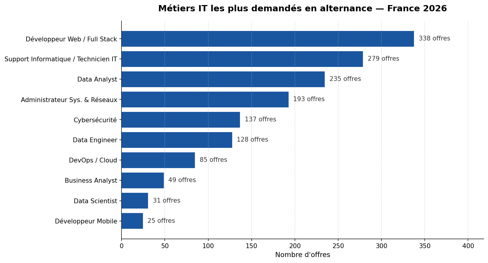
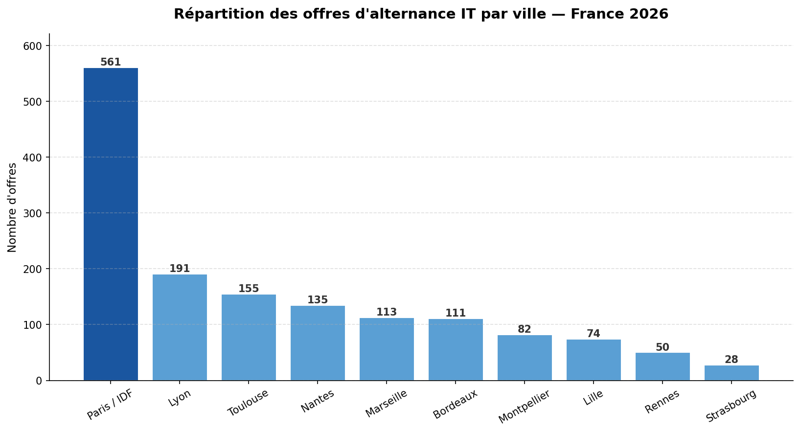
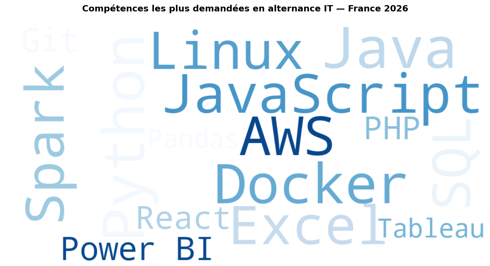
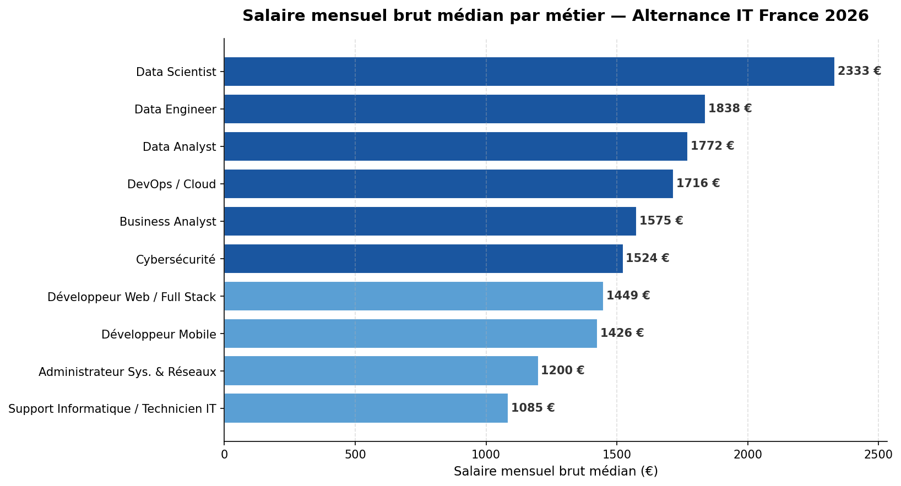
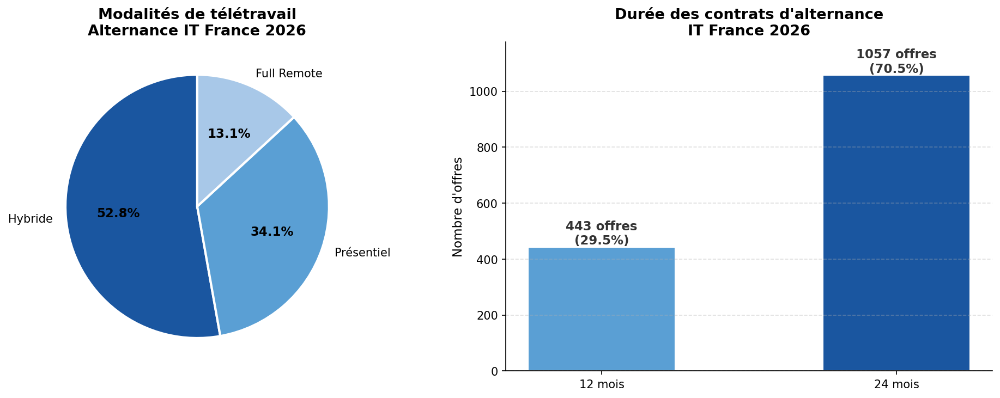

# 📊 Analyse du Marché de l'Alternance IT en France — 2026


## 📌 Description

Analyse exploratoire (EDA) de **1 500 offres d'alternance IT en France (2026)**,
construite à partir des tendances réelles du marché (Indeed, Hellowork, Glassdoor).

L'objectif : identifier les **métiers les plus demandés**, les **villes qui recrutent**,
les **compétences clés** et les **salaires médians** par profil.

---

## 🗂️ Structure du projet 
eda-alternance-france-2026/
│
├── eda_alternance_france_2026.ipynb   # Notebook principal
├── alternances_france_2026.csv        # Dataset généré
│
├── graphe1_metiers.png                # Métiers les plus demandés
├── graphe2_villes.png                 # Répartition géographique
├── graphe3_wordcloud.png              # Compétences les plus citées
├── graphe4_salaires_metier.png        # Salaires médians par métier
├── graphe5_teletravail_duree.png      # Télétravail & durée de contrat

---

## 🔍 Insights clés

- 🏆 **Développeur Web / Full Stack** est le métier le plus demandé
- 🌍 **Paris / IDF** concentre ~38% des offres, suivi de Lyon et Toulouse
- 💰 **Data Scientist** et **Data Engineer** sont les profils les mieux rémunérés
- 💻 **Python** et **SQL** sont les compétences les plus citées dans les offres
- 🏠 Le mode **hybride** domine à 52% des offres en 2026
- 📅 Les contrats **24 mois** représentent 70% des offres

---

## 📊 Aperçu des visualisations

### Métiers les plus demandés


### Répartition géographique


### Compétences les plus demandées


### Salaires médians par métier


### Télétravail & Durée de contrat


---

## 🛠️ Stack technique

| Outil | Usage |
|-------|-------|
| Python 3 | Langage principal |
| Pandas | Manipulation des données |
| Matplotlib | Visualisations |
| WordCloud | Nuage de mots |
| Jupyter Notebook | Environnement d'analyse |

---

## ▶️ Lancer le projet

```bash
# Installer les dépendances
pip install pandas matplotlib wordcloud notebook

# Lancer Jupyter
jupyter notebook eda_alternance_france_2026.ipynb
```

---

## 📝 Source des données

Dataset synthétique généré à partir des tendances réelles du marché 2026 :
- **Indeed France** — volumes d'offres par ville et métier
- **Hellowork** — répartition sectorielle
- **Glassdoor France** — fourchettes salariales en alternance
- **Jooble** — salaires médians Data Analyst / Data Scientist

---

## 👤 Auteur

**Fanel BALEMO** — Étudiant L2 MIASHS · Réseau MIAGE · Université Toulouse III  
🔗 [github.com/Fanel-B](https://github.com/Fanel-B)  
📧 bfanel2005@gmail.com
